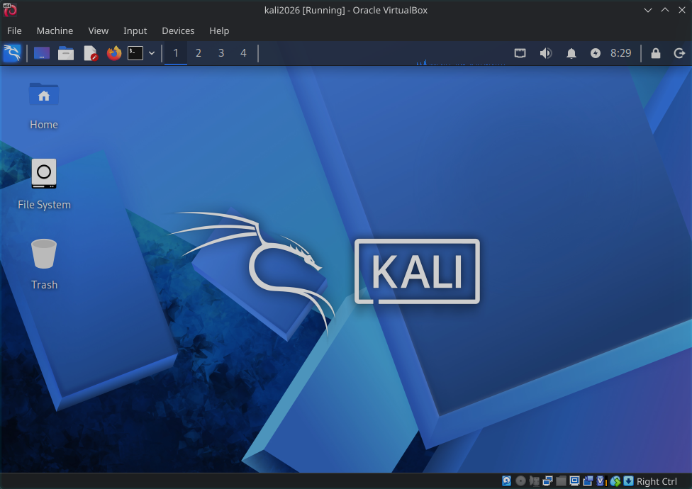
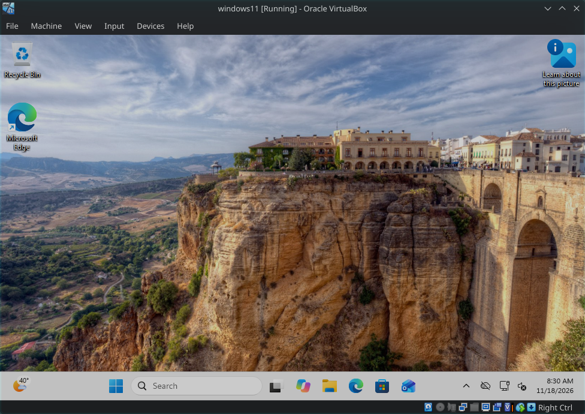

# Building a CyberLab, Part 2: System Virtualization
<br>

So now we've got ourselves an almost passable lab environment.
<br>

Let's step inside and take a look at our handiwork.

```bash
stone@stone:~$ cd ./CyberLab/
stone@stone:~/CyberLab$ ls -l
total 0
```

It's empty. Lovely.

Unfortunately, a more ambitious version of myself decided to call this place `CyberLab` instead of `EmptyLab`, so we've still got some work to do. Some virtualization equipment would undoubtedly be useful here *and* it would make good use of that dedicated storage we set up in the previous project, so let's start there.

First things first, we're going to need something capable of turning this empty directory into a collection of virtual computers. For that, we'll need a hypervisor. I've decided to go with VirtualBox because it's free and because I've already spent too much time staring at the VBoxManage documentation to not use it now. We'll install that along with the VirtualBox Guest Additions ISO.

```bash
stone@stone:~/CyberLab$ sudo apt install virtualbox virtualbox-guest-additions-iso
```

Guest Additions aren't strictly necessary to run virtual machines, but they do provide some rather nice quality-of-life improvements, including automatic screen resizing (which is especially helpful if you have a tiling window manager) and the ability to enable a bidirectional clipboard so you can easily copy/paste things between VMs or to/from the host machine. I would probably lose my mind trying to do any serious work in VirtualBox without them.

That being said, I have absolutely no idea where the package manager decided to put that ISO file, so we'll have to ask.

```bash
stone@stone:~/CyberLab$ dpkg -L virtualbox-guest-additions-iso | grep '\.iso$'
/usr/share/virtualbox/VBoxGuestAdditions.iso
```

Nice. Let's make a directory in our CyberLab to store our ISO files and copy it over.

```bash
stone@stone:~/CyberLab$ mkdir -p ./VMs/ISOs/
stone@stone:~/CyberLab$ cp /usr/share/virtualbox/VBoxGuestAdditions.iso ./VMs/ISOs/
stone@stone:~/CyberLab$ ls ./VMs/ISOs/
VBoxGuestAdditions.iso
```

Look at that. Our CyberLab's very first file, and it's just a DVD that's effectively useless by itself. It's okay, we'll find it some friends on the internet.

I'm going to grab a Windows 11 ISO from [microsoft.com](https://www.microsoft.com/software-download/windows11) and a Kali Linux ISO from [kali.org](https://www.kali.org/get-kali/#kali-installer-images). These files are several gigabytes apiece, so it'll probably take a little while to download them. You *could* use this time to finally go wash your dishes, but we both know you won't.

Once the downloads are complete, we'll move them into that same ISO directory we just created. The `mv` command also gives us an opportunity to rename the files to something a little less obnoxious, so let's do that too.

```bash
stone@stone:~/CyberLab$ ls ~/Downloads/
kali-linux-2026.3-installer-amd64.iso  Windows11_Client_x64_en-us_26300_9457.iso
stone@stone:~/CyberLab$ mv ~/Downloads/kali-linux-2026.3-installer-amd64.iso ./VMs/ISOs/kali2026.iso
stone@stone:~/CyberLab$ mv ~/Downloads/Windows11_Client_x64_en-us_26300_9457.iso ./VMs/ISOs/windows11.iso
stone@stone:~/CyberLab$ ls ./VMs/ISOs/
kali2026.iso  VBoxGuestAdditions.iso  windows11.iso
```

Okay. So now we have *three* DVDs in our CyberLab, which is a bit better, but it's still not especially 'cyber'. To change that, we're going to use that fancy hypervisor we installed earlier to transmutate these unassuming DVDs into two fully functional, virtualized computers. Fortunately, VirtualBox (the aforementioned fancy hypervisor) has a reasonably intuitive graphical interface that makes creating virtual machines a breeze.

That said, we won't be using it. Point-and-click interfaces are for the common folk. Wizards use the terminal.

Before we start throwing virtual hardware at our machines, let's see if VirtualBox can figure out what operating systems we're trying to install. It has a feature called *unattended installation* that can automate a good chunk of the installation process for us, assuming VirtualBox has a matching installation profile for each operating system.

Let's try asking VirtualBox to detect the operating system on each ISO.

```bash
stone@stone:~/CyberLab$ vboxmanage unattended detect --iso=./VMs/ISOs/windows11.iso 
VBoxManage: info: Detected '/home/stone/CyberLab/VMs/ISOs/windows11.iso' to be:
    OS TypeId    = Windows11_64
    OS Version   = 10.0.26300.9457
    OS Flavor    = Core
    OS Languages = en-US
    OS Hints     = 
    ...
    Unattended installation supported = yes
stone@stone:~/CyberLab$ vboxmanage unattended detect --iso=./VMs/ISOs/kali2026.iso 
VBoxManage: error: Code NS_ERROR_NOT_IMPLEMENTED (0x80004001) - Not implemented (extended info not available)
VBoxManage: error: Context: "DetectIsoOS()" at line 2235 of file VBoxManageMisc.cpp
VBoxManage: info: Detected '/home/stone/CyberLab/VMs/ISOs/kali2026.iso' to be:
    OS TypeId    = Ubuntu_64
    OS Version   = 
    OS Flavor    = 
    OS Languages = en-US
    OS Hints     = 
    Unattended installation supported = no
```

Hmm. Windows appears to have been detected successfully, while Kali isn't giving us the same treatment. In this case, VirtualBox doesn't provide a usable unattended installation profile for the Kali ISO. Oh well, we tried our best.

However, if we take a second look at the output, we'll also notice that VirtualBox has given us the OS type identifiers it recognizes for each installation. We'll keep those in mind when creating our virtual machines, which we can do right now.

We'll start with Windows.

```bash
stone@stone:~/CyberLab$ vboxmanage createvm --name=windows11 --ostype=Windows11_64 --basefolder=/home/stone/CyberLab/VMs/ --register
Virtual machine 'windows11' is created and registered.
UUID: c6fcb2ff-2e6b-4359-86e5-b77ea5c388fa
Settings file: '/home/stone/CyberLab/VMs/windows11/windows11.vbox'
```

And now for Kali. VirtualBox seems to think it's looking at an Ubuntu installation, which isn't quite right. We know Kali is Debian-based, so surely Debian would be a better fit, right? Does VirtualBox even have a Kali-specific profile?

```bash
stone@stone:~/CyberLab$ vboxmanage list ostypes | grep -i kali.*_64 
stone@stone:~/CyberLab$ vboxmanage list ostypes | grep -i debian.*_64 
ID / Description: Debian_64 -- Debian (64-bit)
ID / Description: Debian4_64 -- Debian 4.0 Etch (64-bit)
ID / Description: Debian5_64 -- Debian 5.0 Lenny (64-bit)
ID / Description: Debian6_64 -- Debian 6.0 Squeeze (64-bit)
ID / Description: Debian7_64 -- Debian 7 Wheezy (64-bit)
ID / Description: Debian8_64 -- Debian 8 Jessie (64-bit)
ID / Description: Debian9_64 -- Debian 9 Stretch (64-bit)
ID / Description: Debian10_64 -- Debian 10 Buster (64-bit)
ID / Description: Debian11_64 -- Debian 11 Bullseye (64-bit)
ID / Description: Debian12_64 -- Debian 12 Bookworm (64-bit)
ID / Description: Debian13_64 -- Debian 13 Trixie (64-bit)
```

Well, that answers that. No Kali-specific profile here, so we'll have to be happy with the Debian_64 installation profile instead. It's not a perfect match, but it's close enough for our purposes.

```bash
stone@stone:~/CyberLab$ vboxmanage createvm --name=kali2026 --ostype=Debian_64 --basefolder=/home/stone/CyberLab/VMs/ --register
Virtual machine 'kali2026' is created and registered.
UUID: 68d699c7-d9a4-4118-aa0e-e5d15b77b388
Settings file: '/home/stone/CyberLab/VMs/kali2026/kali2026.vbox'
```

There. We now have two virtual machines registered with VirtualBox. But considering they don't have any memory, processors, or storage media, they have about as much in common with a computer as they do with that sink full of dishes.

It's cool. We can fix that. (The machines, not the dishes)

We'll start by giving each machine a barely respectable 4 GB (4096 MB) of RAM and two processors, which I'm sure my already-overworked host machine will be happy to lend me.

```bash
stone@stone:~/CyberLab$ vboxmanage modifyvm windows11 --memory=4096 --cpus=2
stone@stone:~/CyberLab$ vboxmanage modifyvm kali2026 --memory=4096 --cpus=2
```

Unsurprisingly, Windows 11 has some additional demands. In particular, it expects UEFI firmware and TPM 2.0 support or it won't behave. It's whatever. VirtualBox can emulate both, so let's enable them.

```bash
stone@stone:~/CyberLab$ vboxmanage modifyvm windows11 --firmware=efi --tpm-type=2.0
```

Now, let's give our machines somewhere to store all their precious data.

VirtualBox uses virtual hard disks to give our virtual machines somewhere to store their virtual stuff (I sound like a virtual crazy person right now). These disks are essentially files on our host machine that behave like physical hard drives from the perspective of the guest operating system.

We'll create two of them using the `createmedium` command. Windows 11 requires at least 64 GB of storage, so we'll give it a 64 GB virtual disk. Kali will get a more modest 30 GB.

(Unless we tell it otherwise, VirtualBox will default to creating a *dynamically allocated* virtual drive, which just means it'll only take up the space it needs on our physical drive rather than immediately gobbling up the full capacity we've given it. This is all cool and good, so we won't change it.)

```bash
stone@stone:~/CyberLab$ vboxmanage createmedium disk --size=65536 --filename=./VMs/windows11/windows11hdd.vdi
0%...10%...20%...30%...40%...50%...60%...70%...80%...90%...100%
Medium created. UUID: c9028873-ba21-4319-9306-6d358278e3ec
stone@stone:~/CyberLab$ vboxmanage createmedium disk --size=30720 --filename=./VMs/kali2026/kali2026hdd.vdi
0%...10%...20%...30%...40%...50%...60%...70%...80%...90%...100%
Medium created. UUID: 1b9762ff-778f-4021-936d-d8dcad8b82a9
```

Of course, those hard drives aren't going to connect themselves. We'll need to give each machine a storage controller to manage the drives we're attaching. I'll be using SATA for no particular reason, and I'll give each controller two ports.

```bash
stone@stone:~/CyberLab$ vboxmanage storagectl windows11 --add=sata --name=sata-controller --portcount=2 --bootable=on
stone@stone:~/CyberLab$ vboxmanage storagectl kali2026 --add=sata --name=sata-controller --portcount=2 --bootable=on
```

Phenomenal. Let's attach the hard drives while they're still fresh.

```bash
stone@stone:~/CyberLab$ vboxmanage storageattach windows11 --storagectl=sata-controller --port=0 --medium=./VMs/windows11/windows11hdd.vdi --type=hdd
stone@stone:~/CyberLab$ vboxmanage storageattach kali2026 --storagectl=sata-controller --port=0 --medium=./VMs/kali2026/kali2026hdd.vdi --type=hdd
```

And let's give each machine an empty optical drive while we're at it. Seeing as how we've already acquired a small collection of DVDs, it's bound to come in handy sooner or later.

```bash
stone@stone:~/CyberLab$ vboxmanage storageattach windows11 --storagectl=sata-controller --port=1 --medium=emptydrive --type=dvddrive
stone@stone:~/CyberLab$ vboxmanage storageattach kali2026 --storagectl=sata-controller --port=1 --medium=emptydrive --type=dvddrive
```

Before we get too carried away, let's make sure VirtualBox actually did everything we asked it to.

```bash
stone@stone:~/CyberLab$ vboxmanage showvminfo windows11
Name:                        windows11
...
Guest OS:                    Windows 11 (64-bit)
...
Memory size:                 4096MB
...
Number of CPUs:              2
...
Storage Controllers:
#0: 'sata-controller', Type: IntelAhci, Instance: 0, Ports: 2 (max 30), Bootable
  Port 0, Unit 0: UUID: c9028873-ba21-4319-9306-6d358278e3ec
    Location: "/home/stone/CyberLab/VMs/windows11/windows11hdd.vdi"
  Port 1, Unit 0: Empty
...
stone@stone:~/CyberLab$ vboxmanage showvminfo kali2026
Name:                        kali2026
...
Guest OS:                    Debian (64-bit)
...
Memory size:                 4096MB
...
Number of CPUs:              2
...
Storage Controllers:
#0: 'sata-controller', Type: IntelAhci, Instance: 0, Ports: 2 (max 30), Bootable
  Port 0, Unit 0: UUID: 1b9762ff-778f-4021-936d-d8dcad8b82a9
    Location: "/home/stone/CyberLab/VMs/kali2026/kali2026hdd.vdi"
  Port 1, Unit 0: Empty
...
```
Beautiful. Both machines have their allotted memory and processors, their hard drives are attached, and they've each got an empty optical drive waiting for something to read. Everything appears to be in order, so let's put that unattended installation feature we touched on earlier to good use.

We'll use the `unattended install` command to tell VirtualBox which ISO to use for installation, what credentials to configure during setup, and where to find our Guest Additions ISO. The `--install-additions` flag is just there to tell VirtualBox to actually install Guest Additions, since it apparently can't figure out what the `--additions-iso` is for otherwise.

For the sake of simplicity, my username and password choices here are going to be pretty uninspired. Don't come at me.

```bash
stone@stone:~/CyberLab$ vboxmanage unattended install windows11 --iso=./VMs/ISOs/windows11.iso --user=windows --password=windows --install-additions --additions-iso=./VMs/ISOs/VBoxGuestAdditions.iso
VBoxManage: info: Preparing unattended installation of Windows11_64 in machine 'windows11' (c6fcb2ff-2e6b-4359-86e5-b77ea5c388fa).
VBoxManage: info: Using values:
                           isoPath = /home/stone/CyberLab/VMs/ISOs/windows11.iso
                              user = windows
                          password = windows
                     user-password = windows
...
                  additionsIsoPath = /home/stone/CyberLab/VMs/ISOs/VBoxGuestAdditions.iso
             installGuestAdditions = true
...
VBoxManage: info: VM 'windows11' (c6fcb2ff-2e6b-4359-86e5-b77ea5c388fa) is ready to be started (e.g. VBoxManage startvm).

```

Stellar. VirtualBox has everything it needs to handle the installation for us, so let's fire up the machine and see what happens.

```bash
stone@stone:~/CyberLab$ vboxmanage startvm windows11
Waiting for VM "windows11" to power on...
VM "windows11" has been successfully started.
```

At this point, VirtualBox should take care of the installation for us. We can keep an eye on things through the VM window, but there's not much left to do. Let's turn our attention to Kali.

Since our Kali ISO didn't provide us with a usable unattended installation profile, we're going to have to handle this one ourselves. Fortunately, that's not particularly difficult. We can start by inserting the Kali ISO directly into the optical drive we added earlier.

```bash
stone@stone:~/CyberLab$ vboxmanage storageattach kali2026 --storagectl=sata-controller --port=1 --medium=./VMs/ISOs/kali2026.iso --type=dvddrive
```

Now let's start the machine.

```bash
stone@stone:~/CyberLab$ vboxmanage startvm kali2026
Waiting for VM "kali2026" to power on...
VM "kali2026" has been successfully started.
```

The virtual machine should boot directly from the installation ISO. We'll just follow the installation prompts to configure Kali Linux and install it onto the virtual hard disk we created earlier. I'll stick with the default options and use `kali` for both the username and password.

Once the installation is complete, Kali will prompt us to remove the installation media before rebooting. Since we're using the command line to manage our virtual hardware, let's oblige.

```bash
stone@stone:~/CyberLab$ vboxmanage storageattach kali2026 --storagectl=sata-controller --port=1 --medium=emptydrive --type=dvddrive
```

With the Kali ISO removed, we can now reboot into our freshly installed operating system. Go ahead and reboot from the Kali VM window. Once it's back up, we should be able to log in and marvel at our cool new virtual desktop.



Perfect. We've got ourselves a fully functional Kali Linux virtual machine. And as a little bonus, it already comes with a current-enough version of Guest Additions installed and ready to do God's work.

By now, our Windows installation should have finished cooking too. Let's take a peek.



Excellent. By this point, both of our virtual machines should also have Guest Additions installed and running. Now we can bestow upon them the multiversal power that is *_bidirectional clipboard sharing_*.

```bash
stone@stone:~/CyberLab$ vboxmanage controlvm windows11 clipboard mode bidirectional
stone@stone:~/CyberLab$ vboxmanage controlvm kali2026 clipboard mode bidirectional

```

And there we have it. We've gone from an empty directory to two fully functional virtual machines, each with its own operating system, virtual hard drive, and a few extra quality-of-life improvements to make life a little... quality-er.

Our CyberLab is finally starting to look a little more deserving of its name. We've got the storage, the virtualization, and a couple of operating systems to play with. All that's missing now is an actual network environment.

I guess that means we're doing a Part 3.


